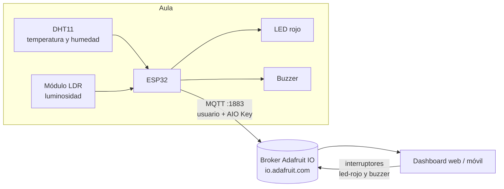

# Monitoreo Inteligente de Aula - Semana 12: Plataformas IoT en la nube (Adafruit IO)

Proyecto integrador de Internet de las Cosas (UTS). Un ESP32 lee temperatura, humedad y luminosidad,
las publica en **Adafruit IO** mediante MQTT autenticado y recibe comandos desde un dashboard para
controlar un LED rojo y un buzzer.

**Autores:** Brayan Sneider Rincón Ardila y María Fernanda Cáceres Ortiz

---

## 1. Arquitectura



Flujo de datos:

1. El ESP32 publica cada 15 s en `usuario/feeds/temperatura`, `humedad` y `luminosidad`.
2. Adafruit IO guarda el histórico y actualiza los widgets del dashboard.
3. Los interruptores del dashboard escriben en `usuario/feeds/led-rojo` y `usuario/feeds/buzzer`.
4. El ESP32 está suscrito a esos dos feeds y ejecuta el comando en su callback MQTT.

## 2. Hardware y conexiones

| Componente | Pin del ESP32 |
|---|---|
| DHT11 (DATA) | GPIO 27 |
| Módulo LDR (DO) | GPIO 34 |
| LED rojo (con resistencia de 220 Ω) | GPIO 26 |
| Buzzer activo (+) | GPIO 33 |
| Alimentación de sensores | 3V3 y GND |

Materiales: ESP32 Dev Kit de 38 pines, DHT11, módulo LDR, LED rojo, resistencia de 220 Ω,
buzzer activo, protoboard y cables.

## 3. Feeds y dashboard

| Feed | Tipo | Widget |
|---|---|---|
| `temperatura` | Lectura | Gráfico de línea (histórico de 24 h) |
| `humedad` | Lectura | Gauge (0 a 100 %) |
| `luminosidad` | Lectura | Indicador de color (verde con luz, rojo en oscuridad) |
| `led-rojo` | Escritura | Interruptor (Toggle) |
| `buzzer` | Escritura | Interruptor (Toggle) |

## 4. Estructura del repositorio

```
semana12/
├── semana12_adafruit.ino   # Código del ESP32
├── config.h.example        # Plantilla de credenciales (sí se sube)
├── config.h                # Credenciales reales (NO se sube, está en .gitignore)
├── .gitignore
├── README.md
└── docs/                   # Capturas y respuestas de reflexión
```

## 5. Cómo replicar el proyecto

1. **Cuenta y feeds:** crea una cuenta en [io.adafruit.com](https://io.adafruit.com), entra a *Feeds → New Feed*
   y crea `temperatura`, `humedad`, `luminosidad`, `led-rojo` y `buzzer`.
2. **Credenciales:** con el ícono de la llave (*AIO Key*) copia tu usuario y tu clave.
3. **Dashboard:** crea un dashboard y agrega los cinco bloques de la tabla de la sección 3.
4. **Arduino IDE:** instala las librerías *PubSubClient* (Nick O'Leary) y *DHT sensor library* (Adafruit),
   y selecciona la placa *ESP32 Dev Module*.
5. **Configuración:** copia `config.h.example` como `config.h` y escribe tu WiFi (2.4 GHz), tu usuario y tu AIO Key.
6. **Montaje:** conecta los componentes según la sección 2.
7. **Carga:** sube `semana12_adafruit.ino` y abre el Monitor Serial a 115200 baudios.

## 6. Pruebas realizadas

| Prueba | Cómo se verificó | Resultado esperado |
|---|---|---|
| Publicación | Monitor Serial y dashboard | Los widgets se actualizan cada 15 s |
| Control remoto | Interruptor *led-rojo* desde el celular | El LED físico se enciende y el Serial muestra `LED rojo ENCENDIDO` |
| Control del buzzer | Interruptor *buzzer* | El buzzer suena y el Serial muestra `Buzzer ACTIVADO` |
| Resiliencia | Se apaga la red WiFi y se vuelve a encender | El ESP32 reconecta solo y el dashboard conserva el último valor conocido |

## 7. Capturas y video

- Dashboard funcionando: `docs/dashboard.png`
- Monitor Serial: `docs/serial.png`
- Montaje físico: `docs/montaje.jpg`
- Video de demostración (máx. 3 min): _pegar aquí el enlace_

## 8. Seguridad de credenciales

El SSID, la clave WiFi y la AIO Key se guardan en `config.h`, que está en `.gitignore`.
En el repositorio solo existe `config.h.example` con valores de ejemplo. Si una clave se publica por
error, hay que regenerarla desde el panel de Adafruit IO.

## 9. Referencias

- Adafruit. (2024). *Adafruit IO Documentation*. https://learn.adafruit.com/adafruit-io
- O'Leary, N. *PubSubClient: Arduino Client for MQTT*. https://pubsubclient.knolleary.net/
- Presentación Semana 12. *Plataformas IoT en la Nube: Blynk y Adafruit IO*. Asignatura IoT, UTS.
