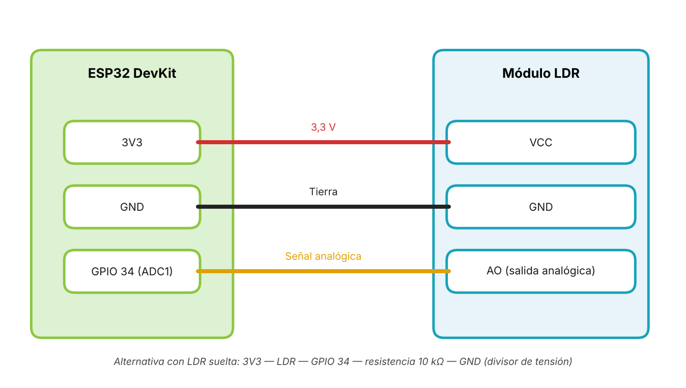
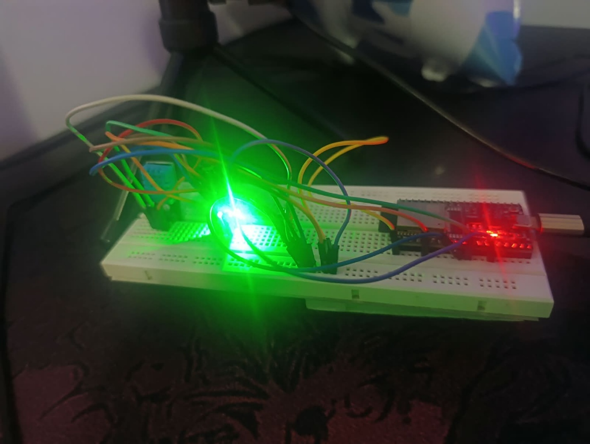
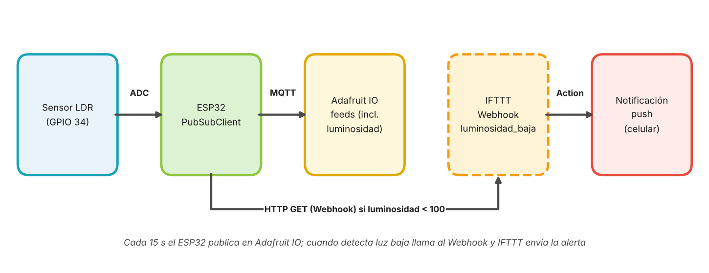
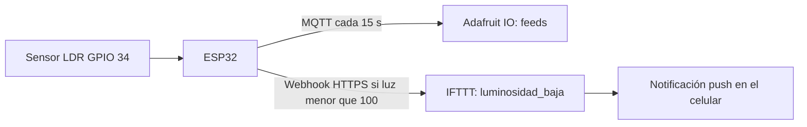
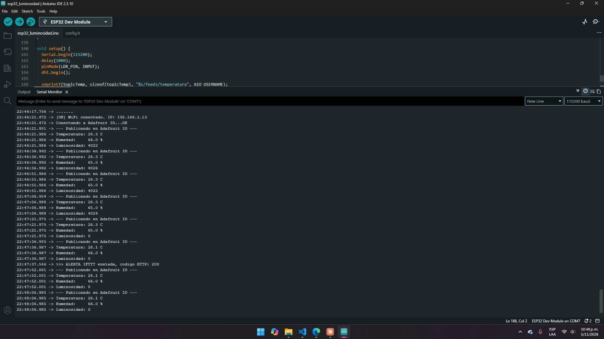
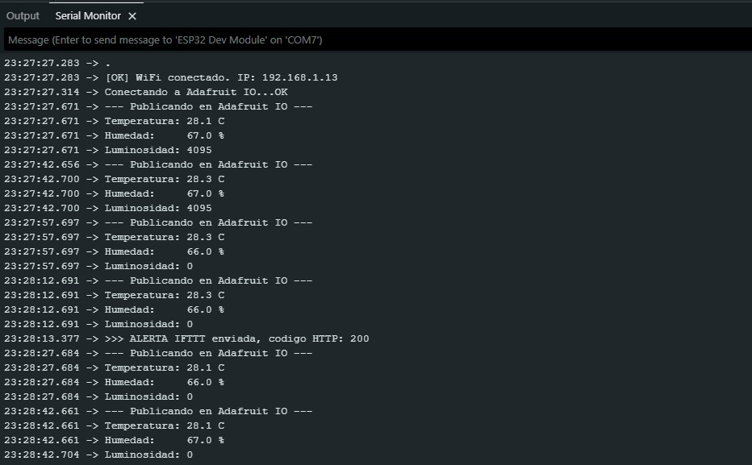
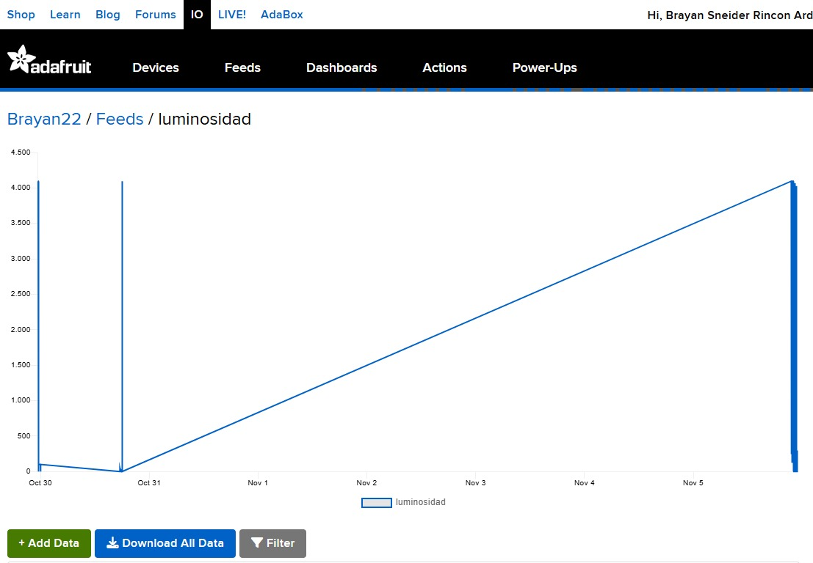
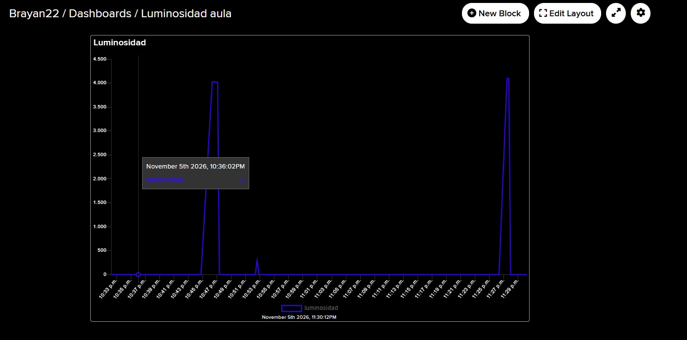
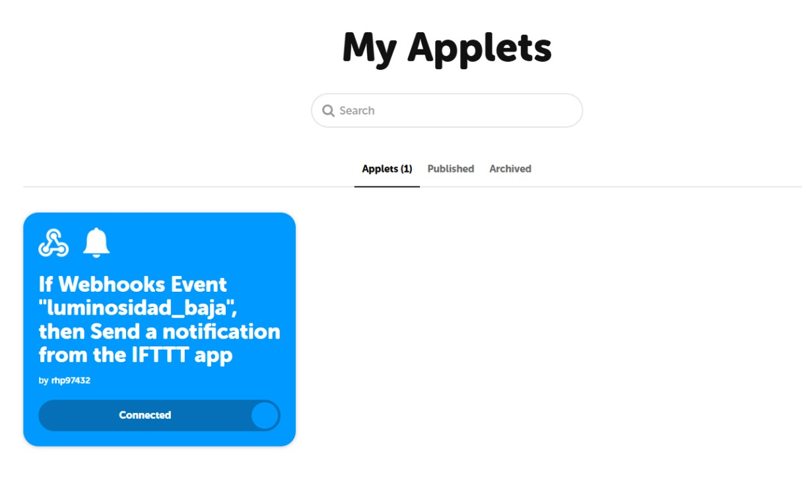
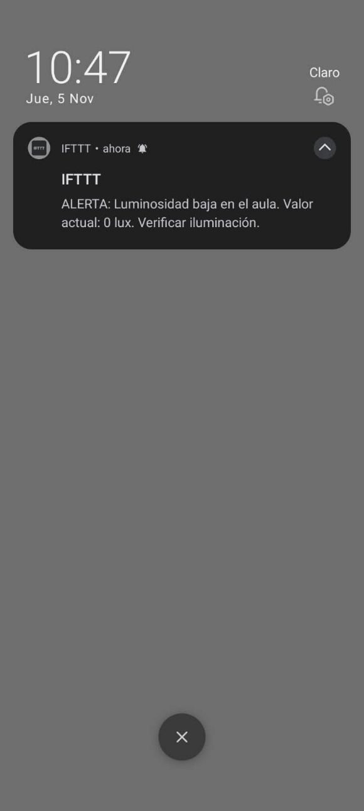

# Proyecto IoT – Semana 13: Automatización con IFTTT

**Materia:** Internet de las cosas (IoT) · Unidades Tecnológicas de Santander
**Docente:** Eliecer Montero Ojeda
**Autores:** María Fernanda Cáceres Ortiz y Brayan Sneider Rincon Ardila

## 1. Descripción del proyecto

El proyecto integrador de clase (**Monitoreo Inteligente de Aula**) usa un ESP32 con un sensor DHT11, un módulo LDR, un LED rojo y un buzzer. En la semana 13 se le añade una **alerta automática por poca luz**: el ESP32 publica temperatura, humedad y luminosidad en **Adafruit IO** cada 15 s y, cuando la luminosidad es menor que **100** durante 2 lecturas seguidas, llama a un **Webhook de IFTTT** (evento `luminosidad_baja`) que envía una **notificación push** al celular. Así el coordinador no necesita estar frente al dashboard.

> **Nota sobre la escala:** el módulo LDR no mide lux reales. El código publica el valor del ADC (0–4095) con la escala invertida (`INVERTIR_LUZ true`): 0 es oscuridad y cerca de 4095 es luz intensa. Para lux reales se puede usar un sensor BH1750.

## 2. Diagrama de conexión



| Componente | Pin ESP32 |
|---|---|
| LDR módulo (AO) | GPIO 34 (ADC1, solo entrada) |
| LDR módulo (VCC / GND) | 3V3 / GND |
| DHT11 (DATA) | GPIO 27 |
| LED rojo y buzzer | GPIO 26 y 33 (sin uso en esta actividad) |



## 3. Flujo del sistema

Sensor → ESP32 → Adafruit IO → IFTTT → Notificación push





1. El ESP32 promedia 20 lecturas del LDR y las invierte (4095 menos el promedio).
2. Cada 15 s publica `temperatura`, `humedad` y `luminosidad` en Adafruit IO (broker `io.adafruit.com:1883`).
3. Si hay 2 lecturas seguidas menores que 100 (y pasaron 60 s desde la última alerta), llama a `https://maker.ifttt.com/trigger/luminosidad_baja/with/key/<IFTTT_KEY>?value1=<valor>`.
4. El Applet **If Webhooks Event «luminosidad_baja», then Send a notification from the IFTTT app** envía:
   `ALERTA: Luminosidad baja en el aula. Valor actual: {{Value1}} lux. Verificar iluminación.`
5. `reconnect()` restablece WiFi y MQTT cada 5 s sin bloquear el programa.

## 4. Cómo replicarlo

1. Instalar en Arduino IDE las librerías **PubSubClient** (Nick O'Leary) y **DHT sensor library** (Adafruit).
2. Crear en Adafruit IO los feeds `temperatura`, `humedad` y `luminosidad` y un dashboard con un Line Chart de `luminosidad`.
3. En IFTTT crear el Applet con Webhooks (evento `luminosidad_baja`) y la acción *Send a notification from the IFTTT app*; instalar la app IFTTT en el celular.
4. Copiar `codigo/config.h.example` como `codigo/config.h` y escribir WiFi, usuario, AIO Key e IFTTT Key (**no subir ese archivo**; está en `.gitignore`).
5. Cargar `codigo/esp32_luminosidad.ino` en el ESP32 (115200 bps en el monitor serial).
6. Cubrir el sensor hasta que el monitor serial muestre «Luminosidad: 0» y la línea «ALERTA IFTTT enviada, codigo HTTP: 200».

## 5. Capturas de pantalla

| Evidencia | Imagen |
|---|---|
| Monitor serial con lecturas (4022 a 4026 con luz, 0 al cubrir) |  |
| Monitor serial con la alerta enviada (HTTP 200) |  |
| Feed `luminosidad` e historial (557 datos) |  |
| Dashboard con Line Chart (22:33 a 23:30) |  |
| Applet de IFTTT activo |  |
| Notificación push (10:47 p. m., «Valor actual: 0 lux») |  |

## 6. Código fuente comentado

Archivo `codigo/esp32_luminosidad.ino`:

```cpp
/*
 * SEMANA 13 - Adafruit IO + IFTTT (Webhook)
 * Lee TODOS los sensores y los publica en Adafruit IO cada 15 s:
 *   - temperatura (DHT11) -> feed "temperatura"
 *   - humedad     (DHT11) -> feed "humedad"
 *   - luminosidad (LDR)   -> feed "luminosidad"
 * Alerta inmediata: cuando la luminosidad es < 100 el ESP32 llama a un Webhook de IFTTT
 * y el applet envia la notificacion push al celular con el valor.
 *
 * Hardware : ESP32 + DHT11 (DATA -> GPIO 27) + modulo LDR (DO -> GPIO 34)
 * Librerias: PubSubClient (Nick O'Leary) y DHT sensor library (Adafruit)
 * Credenciales en config.h (NO se sube a GitHub).
 */

#include <WiFi.h>
#include <WiFiClientSecure.h>
#include <HTTPClient.h>
#include <PubSubClient.h>
#include <DHT.h>
#include "config.h"

#define DHTPIN  27   // Dato del DHT11
#define DHTTYPE DHT11
#define LDR_PIN 34   // Salida del modulo LDR (solo entrada)

// Con este modulo: MAS luz = numero BAJO, oscuridad = numero ALTO.
// Con true se invierte para que "oscuro" de un numero BAJO (< 100).
#define INVERTIR_LUZ true

const unsigned long INTERVALO_ENVIO     = 15000;  // 15 s
const unsigned long INTERVALO_REINTENTO = 5000;

// --- Alerta por webhook de IFTTT ---
const char*   IFTTT_EVENT          = "luminosidad_baja";  // mismo nombre que en el applet
const int     UMBRAL_LUZ           = 100;
const int     LECTURAS_PARA_ALERTA = 2;       // lecturas seguidas bajo el umbral (1 = inmediato)
const unsigned long ESPERA_ALERTA  = 60000;   // minimo 60 s entre alertas

DHT dht(DHTPIN, DHTTYPE);
WiFiClient espClient;
PubSubClient client(espClient);

char topicTemp[80];
char topicHum[80];
char topicLuz[80];
unsigned long ultimoEnvio = 0;
unsigned long ultimoIntentoMQTT = 0;
unsigned long ultimaAlerta = 0;
bool alertaEnviadaAntes = false;
int lecturasOscuro = 0;

// Promedia 20 lecturas (0-4095); oscuro = valor bajo
int leerLuminosidad() {
  long suma = 0;
  for (int i = 0; i < 20; i++) {
    suma += analogRead(LDR_PIN);
    delay(5);
  }
  int valor = suma / 20;
  if (INVERTIR_LUZ) valor = 4095 - valor;
  return valor;
}

void conectarWiFi() {
  Serial.print("Conectando a WiFi: ");
  Serial.println(WIFI_SSID);

  WiFi.mode(WIFI_STA);
  WiFi.disconnect(true);
  delay(500);
  WiFi.begin(WIFI_SSID, WIFI_PASSWORD);

  unsigned long inicio = millis();
  while (WiFi.status() != WL_CONNECTED && millis() - inicio < 20000) {
    delay(500);
    Serial.print(".");
  }

  if (WiFi.status() == WL_CONNECTED) {
    Serial.println("\n[OK] WiFi conectado. IP: " + WiFi.localIP().toString());
  } else {
    Serial.print("\n[ERROR] Sin WiFi. Estado: ");
    Serial.println(WiFi.status());
  }
}

// reconnect(): mantiene viva la conexion MQTT sin bloquear el loop
void reconnect() {
  if (WiFi.status() != WL_CONNECTED) {
    conectarWiFi();
    return;
  }
  if (!client.connected() && millis() - ultimoIntentoMQTT >= INTERVALO_REINTENTO) {
    ultimoIntentoMQTT = millis();
    Serial.print("Conectando a Adafruit IO...");
    if (client.connect(MQTT_CLIENT_ID, AIO_USERNAME, AIO_KEY)) {
      Serial.println("OK");
      ultimoEnvio = millis() - INTERVALO_ENVIO;   // publica de inmediato
    } else {
      Serial.print("Fallo, rc=");
      Serial.println(client.state());   // 4 = usuario/clave mal, 5 = no autorizado
    }
  }
}

// Llama al webhook de IFTTT mandando el valor como value1
void enviarAlertaIFTTT(int valor) {
  WiFiClientSecure seguro;
  seguro.setInsecure();   // sin verificar certificado (suficiente para el laboratorio)
  HTTPClient http;
  http.setTimeout(8000);

  String url = String("https://maker.ifttt.com/trigger/") + IFTTT_EVENT +
               "/with/key/" + IFTTT_KEY + "?value1=" + String(valor);

  if (http.begin(seguro, url)) {
    int codigo = http.GET();
    Serial.print(">>> ALERTA IFTTT enviada, codigo HTTP: ");
    Serial.println(codigo);   // 200 = IFTTT la recibio
    http.end();
  } else {
    Serial.println(">>> No se pudo iniciar la peticion a IFTTT");
  }
}

void publicarDatos() {
  float temperatura = dht.readTemperature();
  float humedad = dht.readHumidity();
  int luz = leerLuminosidad();

  Serial.println("--- Publicando en Adafruit IO ---");

  if (isnan(temperatura) || isnan(humedad)) {
    Serial.println("[ERROR] Fallo lectura DHT11, revisa el cableado");
  } else {
    client.publish(topicTemp, String(temperatura, 1).c_str());
    client.publish(topicHum, String(humedad, 1).c_str());
    Serial.print("Temperatura: "); Serial.print(temperatura, 1); Serial.println(" C");
    Serial.print("Humedad:     "); Serial.print(humedad, 1); Serial.println(" %");
  }

  client.publish(topicLuz, String(luz).c_str());
  Serial.print("Luminosidad: "); Serial.println(luz);

  // Alerta: luz baja durante LECTURAS_PARA_ALERTA lecturas seguidas
  if (luz < UMBRAL_LUZ) {
    lecturasOscuro++;
  } else {
    lecturasOscuro = 0;
  }

  if (lecturasOscuro >= LECTURAS_PARA_ALERTA &&
      (!alertaEnviadaAntes || millis() - ultimaAlerta >= ESPERA_ALERTA)) {
    enviarAlertaIFTTT(luz);
    ultimaAlerta = millis();
    alertaEnviadaAntes = true;
  }
}

void setup() {
  Serial.begin(115200);
  delay(1000);
  pinMode(LDR_PIN, INPUT);
  dht.begin();

  snprintf(topicTemp, sizeof(topicTemp), "%s/feeds/temperatura", AIO_USERNAME);
  snprintf(topicHum,  sizeof(topicHum),  "%s/feeds/humedad",     AIO_USERNAME);
  snprintf(topicLuz,  sizeof(topicLuz),  "%s/feeds/luminosidad", AIO_USERNAME);

  client.setServer(AIO_SERVER, AIO_PORT);
  ultimoIntentoMQTT = millis() - INTERVALO_REINTENTO;
  conectarWiFi();
}

void loop() {
  reconnect();

  if (client.connected()) {
    client.loop();

    if (millis() - ultimoEnvio >= INTERVALO_ENVIO) {
      ultimoEnvio = millis();
      publicarDatos();
    }
  }
}
```

## 7. Conclusiones sobre la utilidad de la automatización en IoT

- Pasar de observar datos a reaccionar ante ellos hace útil el monitoreo: la alerta llegó al celular a las 10:47 p. m. unos segundos después de la segunda lectura baja.
- IFTTT evita programar correo o servidores en el ESP32; cambiar el mensaje o la acción se hace en el Applet.
- Exigir 2 lecturas seguidas y 60 s entre alertas evita notificaciones repetidas.
- El plan gratuito de Adafruit IO (30 datos por minuto, 30 días de historial) y el de IFTTT (pocos Applets) limitan el uso a largo plazo.

