# Informe técnico: Actividad semana 13 – Automatización con IFTTT

**Monitoreo Inteligente de Aula: alertas de luminosidad con Adafruit IO y notificación push**

- **Curso:** Internet de las cosas (IoT)
- **Programa:** Tecnología en Desarrollo de Sistemas Informáticos
- **Docente:** Eliecer Montero Ojeda
- **Autores:** María Fernanda Cáceres Ortiz y Brayan Sneider Rincon Ardila
- **Fecha:** 05 de noviembre de 2026

> Versión en Markdown del informe `Informe_actividad_semana_13_IoT.docx`; las figuras están en `evidencias/`.

## 1. Objetivos

Esta actividad completa el montaje trabajado en clase a lo largo del curso (Monitoreo Inteligente de Aula) con una automatización: cuando la luminosidad medida por el ESP32 baja de un umbral, el sistema avisa al celular de la persona responsable sin que nadie tenga que mirar el dashboard. Para lograrlo se usa IFTTT como puente entre Adafruit IO y la notificación push.

**Objetivo general**

Construir un flujo completo de IoT que capture la luminosidad con un ESP32, la publique en Adafruit IO y dispare, mediante un Applet de IFTTT, una notificación push en el celular cuando el valor sea menor que 100 lux.

**Objetivos específicos**

- **Configurar el feed:** crear en Adafruit IO el feed luminosidad y las credenciales necesarias para publicar datos desde el ESP32.
- **Visualizar el histórico:** diseñar un dashboard con un Line Chart que permita analizar la tendencia de la luminosidad.
- **Automatizar con IFTTT:** crear un Applet bajo el modelo Trigger-Action (This → That) que reciba el evento enviado por el ESP32 y envíe una notificación.
- **Integrar y validar:** probar el flujo completo, desde el sensor hasta la notificación push recibida en el celular.
- **Documentar:** organizar el código, las evidencias y el README en un repositorio de GitHub con las credenciales protegidas.

## 2. Marco teórico básico

Se presentan los conceptos necesarios para entender cómo un dato medido por el ESP32 se convierte en una alerta en el celular.

- **Automatización en IoT:** Es la capacidad de un sistema de reaccionar por sí solo ante una condición, sin intervención humana. En lugar de que una persona observe un panel, el sistema detecta el evento y ejecuta una acción, como enviar un aviso.
- **IFTTT:** Es una plataforma de automatización en la nube cuyo nombre significa «If This Then That». Conecta servicios distintos mediante reglas llamadas Applets, de modo que no hay que programar un servidor ni enviar los avisos desde el microcontrolador.
- **Applet (Trigger-Action):** Es la regla de IFTTT. El Trigger (This) es la condición que se vigila y la Action (That) es lo que se ejecuta cuando la condición se cumple. En esta actividad, This es «luminosidad menor que 100» y That es una notificación push.
- **Servicio Adafruit en IFTTT:** Permite que un Applet vigile un feed de Adafruit IO con el trigger «Monitor a feed». Se elige el feed y una condición de comparación, por ejemplo «Less than» (menor que) con un valor numérico (Adafruit Industries, s. f.).
- **Notificación push:** Es un mensaje que llega directamente a la pantalla del celular desde la app de IFTTT. El texto puede incluir el valor leído mediante el ingrediente {{Value}}, que IFTTT reemplaza por el dato del feed.
- **Feed e histórico en Adafruit IO:** Un feed es el canal de datos de Adafruit IO (usuario/feeds/nombre_feed) y guarda cada dato con su fecha y hora. El widget Line Chart dibuja ese historial y permite analizar tendencias. El plan gratuito conserva 30 días de datos (Adafruit Industries, s. f.).
- **Luminosidad y lux:** El lux es la unidad de iluminancia. Un LDR cambia su resistencia con la luz, pero el ESP32 solo mide un voltaje (valor ADC de 0 a 4095), por lo que el resultado en lux es una estimación. Un sensor digital como el BH1750 sí entrega lux reales.
- **Frecuencia de publicación:** El ESP32 debe publicar con una frecuencia adecuada (10 a 15 s) para que IFTTT reciba datos nuevos con regularidad y para no superar el límite de 30 datos por minuto del plan gratuito de Adafruit IO.
- **Reconexión MQTT sin delay() largos:** Si el programa se detiene con esperas largas, la sesión MQTT se pierde por falta de mensajes de mantenimiento. Por eso la función reconnect() reintenta con millis() y el bucle principal nunca queda bloqueado.
- **Protección de credenciales:** El SSID, la clave WiFi y la AIO Key se guardan en config.h, que no se sube a GitHub; en el repositorio solo se publica config.h.example con valores de ejemplo.

### Resumen General del Sistema

El montaje de clase del proyecto integrador (Monitoreo Inteligente de Aula) se construyó durante el curso con un **ESP32**, un sensor **DHT11**, un módulo **LDR**, un **LED rojo** y un **buzzer**. En la semana 13 se le añade una alerta automática por poca luz: el módulo LDR mide la luminosidad, el ESP32 la publica en el feed **luminosidad** de **Adafruit IO** junto con la temperatura y la humedad, y cuando el valor es menor que 100 llama a un **Webhook de IFTTT** que envía una notificación push al celular.

- **Situación problema:** el coordinador académico no puede permanecer frente al dashboard de Adafruit IO todo el día revisando los datos ambientales del aula, pero necesita ser notificado de inmediato cuando ocurra una anomalía, por ejemplo, que la luminosidad descienda por debajo de 100 (situación que simula un apagón de luces o un cambio ambiental crítico). En esta actividad el LDR es el sensor que activa la alerta; el DHT11 también publica sus datos, mientras que el LED rojo y el buzzer de la semana 12 permanecen conectados pero no intervienen.

#### Funcionamiento General

- **Lectura del sensor:** el ESP32 promedia 20 lecturas analógicas del LDR en el GPIO 34 y las invierte (4095 menos el promedio) para que la oscuridad dé un valor bajo.
- **Publicación:** cada 15 s publica temperatura, humedad y luminosidad en sus feeds de Adafruit IO, autenticándose con el usuario y la AIO Key.
- **Visualización:** Adafruit IO guarda el dato y el Line Chart del dashboard muestra la evolución de la luminosidad.
- **Evaluación de la condición:** el ESP32 compara la luminosidad con el umbral de 100 y, si hay 2 lecturas seguidas por debajo, llama al Webhook de IFTTT (evento luminosidad_baja).
- **Notificación:** el Applet de IFTTT recibe el evento y envía una notificación push a la app del celular con el valor actual.
- **Recuperación:** si se pierde el WiFi o el broker, reconnect() restablece la conexión cada 5 s sin bloquear el programa.

### Plataforma y servicios elegidos

Se mantiene **Adafruit IO** como broker y dashboard, porque ya se configuró en la semana 12 y guarda el histórico de la luminosidad. **IFTTT** se elige como puente de automatización con el servicio **Webhooks**, porque permite crear la alerta sin programar correo ni servidores desde el ESP32: basta una petición HTTPS al evento, y la app del celular recibe la notificación push sin desarrollo adicional.

### Mapeo de hardware y asignación de pines (GPIO)

Esta actividad usa el sensor de luminosidad como disparador de la alerta, junto con el DHT11 del montaje de clase. En la tabla se listan las conexiones del montaje (Figura 1).

| Componente | Tipo de Periférico | Pin GPIO ESP32 | Modo de Operación | Función en el Sistema |
|---|---|---|---|---|
| Módulo LDR (AO) | Sensor de luz | GPIO 34 | Entrada Analógica (ADC1) | Entrega la señal de luminosidad que se publica en el feed |
| Módulo LDR (VCC) | Alimentación | 3V3 | No aplica | Alimenta el módulo con 3,3 V |
| Módulo LDR (GND) | Tierra | GND | No aplica | Referencia común con el ESP32 |
| Resistencia 10 kΩ | Divisor de tensión | GND y GPIO 34 | No aplica | Solo si se usa un LDR suelto en lugar del módulo |
| DHT11 | Sensor de temperatura y humedad | GPIO 27 | Entrada digital | Publica temperatura y humedad en sus feeds |
| LED rojo y buzzer | Montaje de la semana 12 | GPIO 26 y 33 | Sin uso en esta actividad | Siguen conectados al montaje, pero el código de la semana 13 no los utiliza |

- **Consideración:** el LDR se conecta al GPIO 34, que pertenece al convertidor ADC1 y es solo de entrada. Este convertidor funciona con el WiFi activo, mientras que los pines del ADC2 no. Como el módulo LDR no mide lux reales, el código publica el valor del ADC (0 a 4095) con la escala invertida, de modo que 0 es oscuridad total y cerca de 4095 es luz intensa; el umbral de 100 se aplica sobre esa escala. Con un BH1750 por I2C se obtendrían lux reales.

### Comparación entre la semana 12 y la semana 13

La tabla resume qué aporta la automatización con IFTTT frente al dashboard con control remoto de la semana 12.

| Aspecto | Semana 12 (Adafruit IO) | Semana 13 (Adafruit IO + IFTTT) |
|---|---|---|
| Quién actúa | La persona revisa el dashboard y mueve los interruptores | El sistema detecta la condición y avisa por sí solo |
| Flujo de datos | ESP32 → Adafruit IO → dashboard; comandos en sentido contrario | Sensor → ESP32 → Adafruit IO → IFTTT → notificación push |
| Variable principal | Temperatura, humedad y luminosidad en porcentaje | Luminosidad en escala 0–4095 (invertida), con umbral de 100 |
| Aviso al usuario | Ninguno: hay que abrir el dashboard | Notificación push en el celular |
| Servicios usados | Adafruit IO | Adafruit IO e IFTTT (Webhooks) |

## 3. Pseudocódigo de la lógica completa

```text
INICIO

    // ---------------------------------------------------
    // CONFIGURACIÓN E INICIALIZACIÓN
    // ---------------------------------------------------
    Cargar SSID, CLAVE, USUARIO_AIO, AIO_KEY, IFTTT_KEY desde config.h
    Definir SERVIDOR = "io.adafruit.com", PUERTO = 1883
    Definir PIN_DHT = 27, PIN_LDR = 34, INVERTIR_LUZ = VERDADERO
    Definir INTERVALO_ENVIO = 15 s, INTERVALO_REINTENTO = 5 s
    Definir UMBRAL = 100, LECTURAS_ALERTA = 2, ESPERA_ALERTA = 60 s

    Inicializar Puerto Serial a 115200 bps
    Configurar PIN_LDR como entrada e iniciar el DHT11
    Construir tópicos: USUARIO/feeds/temperatura, humedad y luminosidad
    Iniciar conexión WiFi y configurar servidor MQTT

    // ---------------------------------------------------
    // BUCLE PRINCIPAL
    // ---------------------------------------------------
    HACER REPETIDAMENTE:

        SI WiFi NO conectado O MQTT NO conectado ENTONCES
            Reconnect()
        SINO
            Atender mensajes de mantenimiento (client.loop)
            SI pasaron 15 s ENTONCES
                Leer DHT11; Luminosidad = LeerLuminosidad()
                Publicar temperatura, humedad y luminosidad
                EscribirSerial("Luminosidad: " + Luminosidad)
                Actualizar Contador de lecturas con Luminosidad < 100
                SI Contador >= 2 Y pasaron 60 s ENTONCES
                    EnviarAlertaIFTTT(Luminosidad)
                FIN SI
            FIN SI
        FIN SI

    FIN HACER

    // ---------------------------------------------------
    // FUNCIONES
    // ---------------------------------------------------
    FUNCION LeerLuminosidad():
        Promedio = promedio de 20 lecturas analógicas del LDR
        RETORNAR 4095 - Promedio   // oscuro = valor bajo

    FUNCION Reconnect():   // solo actúa cada 5 s
        SI WiFi NO conectado ENTONCES reiniciar WiFi.begin(); SALIR
        Conectar(ID_CLIENTE, USUARIO_AIO, AIO_KEY)
        SI conectó ENTONCES Programar publicación inmediata
        SINO EscribirSerial("Fallo, rc=" + código de error)

    FUNCION EnviarAlertaIFTTT(valor):
        Hacer GET al Webhook luminosidad_baja con value1 = valor
        EscribirSerial("ALERTA IFTTT enviada, codigo HTTP: " + codigo)

FIN
```

## 4. Diagramas de conexión y de flujo del sistema

La Figura 1 muestra cómo se conecta el módulo LDR al ESP32: alimentación de 3,3 V, tierra común y la salida analógica al GPIO 34.

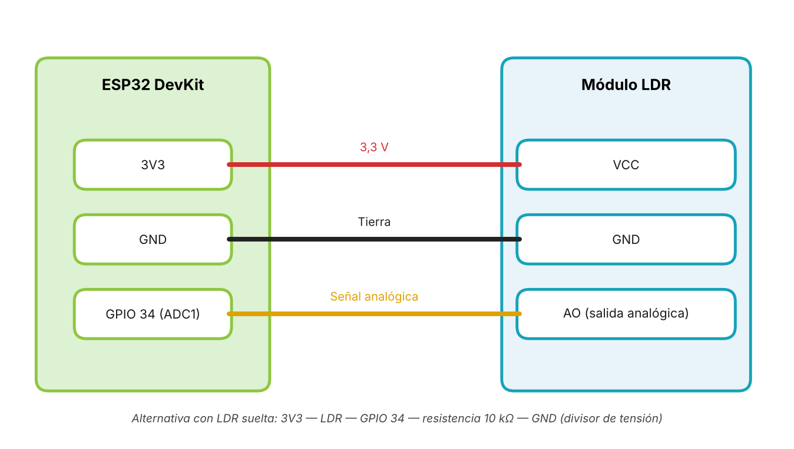

*Figura 1. Diagrama de conexión del módulo LDR al ESP32.*

La Figura 2 presenta el flujo completo de la automatización: Sensor → ESP32 → Adafruit IO → IFTTT → Notificación push.

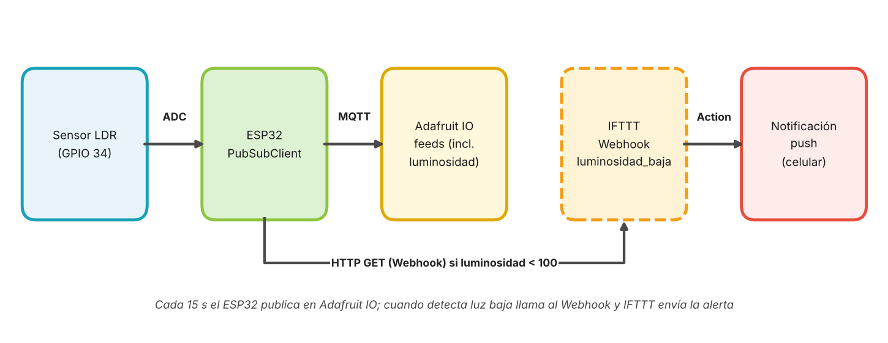

*Figura 2. Flujo del sistema: Sensor → ESP32 → Adafruit IO → IFTTT → Notificación push.*

La Figura 3 describe el flujo del programa del ESP32: configuración inicial, comprobación de las conexiones con reconnect(), mantenimiento de la sesión MQTT y publicación cada 15 s.

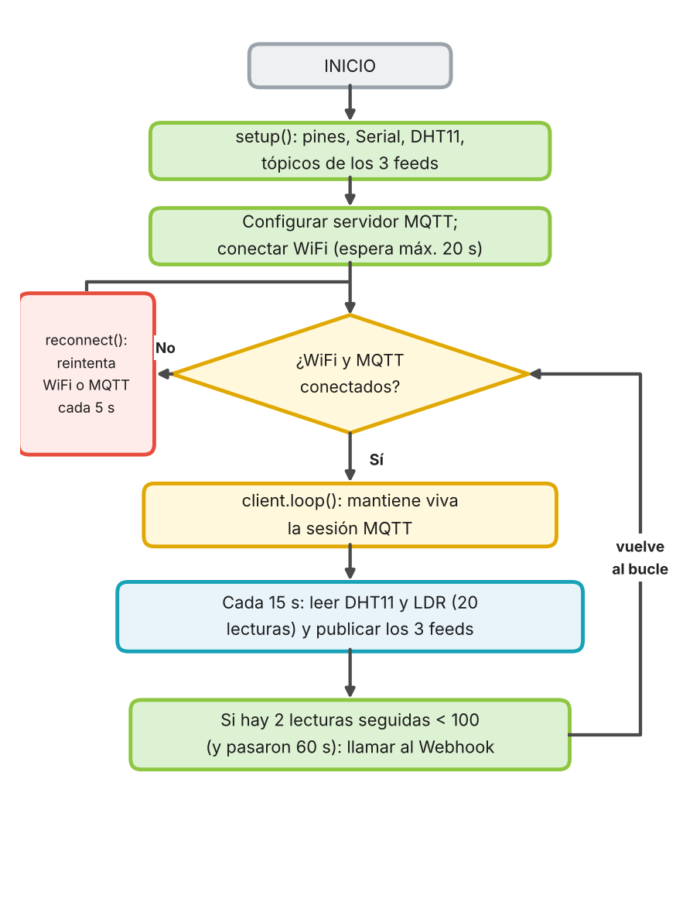

*Figura 3. Diagrama de flujo del programa del ESP32.*

## 5. Fase 1: Reconocimiento y preparación del entorno

Esta fase cubre la conexión del sensor al ESP32 (actividad 1.1) y la configuración de Adafruit IO (actividad 1.2).

#### Conexión del sensor

Se conecta el sensor de luminosidad como indica la Figura 1 y se verifica en el monitor serial que las lecturas varían al cubrir y descubrir el sensor.

| Verificación | Resultado esperado | Resultado obtenido | ¿Cumple? |
|---|---|---|---|
| Lectura con el sensor descubierto | Valor de lux alto, cercano al máximo con buena luz | Con luz ambiental el monitor serial mostró 4022, 4026, 4022 y 4024 (22:46 a 22:47), cerca del máximo de 4095 | Sí |
| Lectura con el sensor cubierto | Valor de lux cercano a 0 | Al cubrir el LDR con la mano el valor cayó a 0 (22:47:21) y se mantuvo en 0 mientras estuvo tapado | Sí |
| Lectura al descubrir de nuevo | El valor vuelve a subir | Al destapar, el valor volvió a subir: 4095 a las 23:27 y un pico intermedio cercano a 300 al destapar parcialmente (gráfico, 22:53) | Sí |
| Estabilidad con luz constante | Variaciones pequeñas entre lecturas | Con luz constante las lecturas variaron solo entre 4022 y 4026 (menos de 0,1 % de la escala); temperatura de 28,3 °C y humedad de 65 a 66 % | Sí |

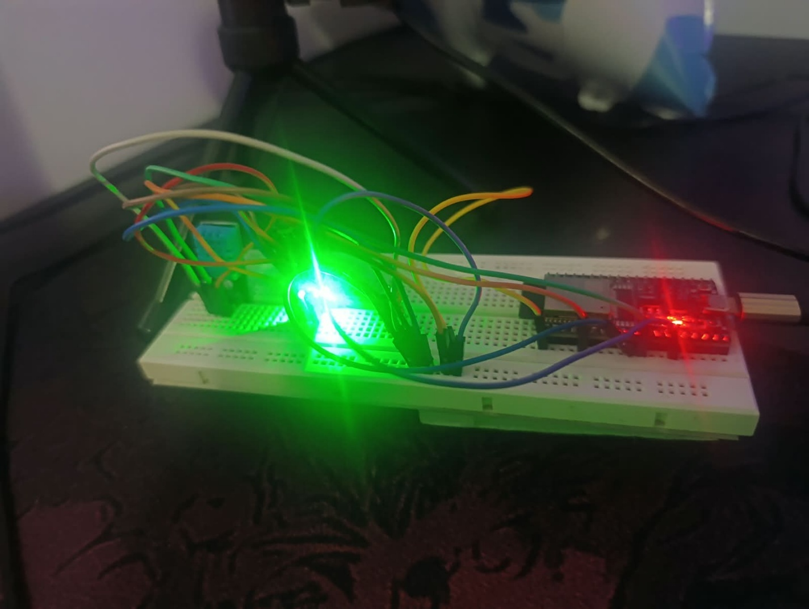

*Figura 4. Montaje de clase con el módulo LDR conectado al ESP32.*

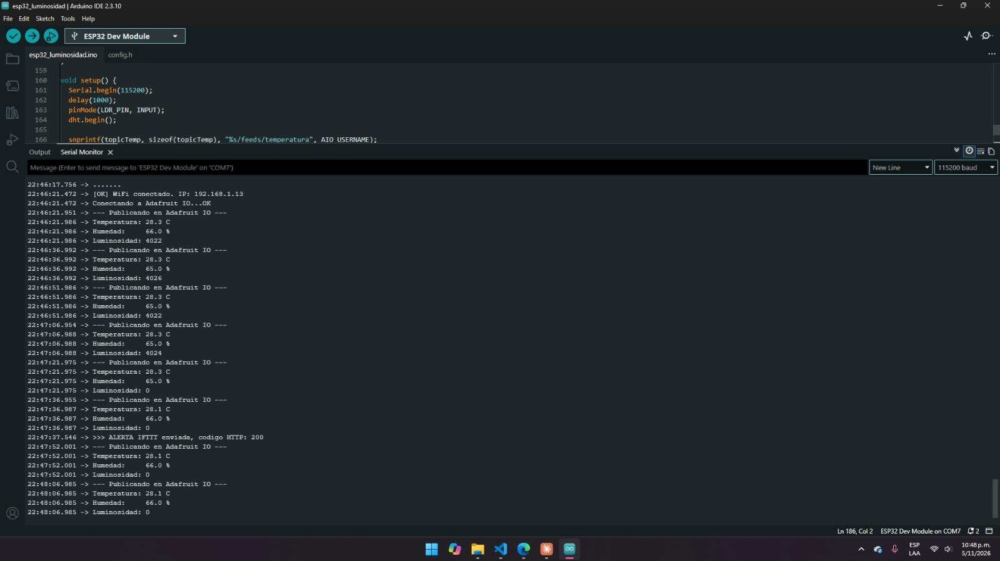

*Figura 5. Monitor serial con las lecturas de luminosidad.*

#### Configuración de Adafruit IO

- **Crear el feed:** en Adafruit IO crear un feed llamado luminosidad, con ese nombre exacto para que coincida con el tópico del código.
- **Obtener las credenciales:** copiar el usuario y la AIO Key y escribirlos en config.h junto con el servidor io.adafruit.com y el puerto 1883.
- **Documentar:** capturar la creación del feed. No se muestra la AIO Key en ninguna captura.

| Parámetro | Valor registrado | Dónde se usa |
|---|---|---|
| Usuario de Adafruit IO (AIO_USERNAME) | Brayan22 | Usuario MQTT y prefijo del tópico |
| AIO Key (AIO_KEY) | [no escribir aquí; solo en config.h] | Contraseña MQTT |
| Servidor (AIO_SERVER) | io.adafruit.com | client.setServer() |
| Puerto (AIO_PORT) | 1883 | client.setServer() |
| Feed | luminosidad | Tópico usuario/feeds/luminosidad |
| Resultado de client.connect() | «Conectando a Adafruit IO...OK» a las 22:46:21, con IP 192.168.1.13; sin códigos rc de error | Monitor serial: «OK» o código rc |

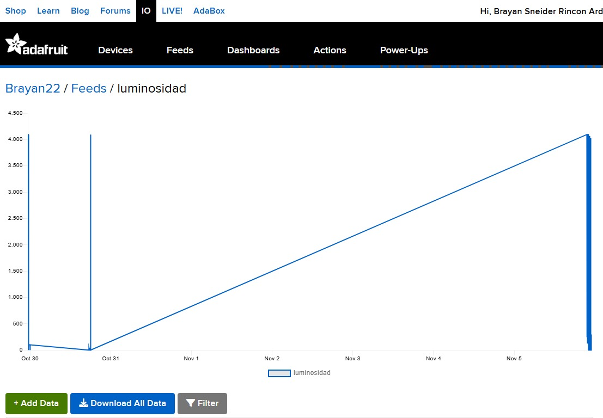

*Figura 6. Feed luminosidad creado en Adafruit IO.*

## 6. Fase 2: Implementación del código y publicación de datos

El código base de la semana 12 se adapta para leer el LDR con la escala invertida, publicar temperatura, humedad y luminosidad cada 15 s y llamar a un Webhook de IFTTT cuando la luz es baja (actividad 2.1). Después se valida la llegada de los datos a la nube (actividad 2.2).

#### Adaptaciones al código base

| Elemento | Semana 12 | Semana 13 |
|---|---|---|
| Sensor | DHT11 y LDR (en porcentaje) | DHT11 y LDR; la luminosidad usa la escala 0–4095 invertida |
| Feeds publicados | temperatura, humedad y luminosidad | temperatura, humedad y luminosidad (3 feeds) |
| Frecuencia de publicación | 15 s | 15 s (dentro del rango de 10 a 15 s) |
| Reconexión | asegurarConexiones() | Función reconnect() con reintento cada 5 s |
| Control remoto | Callback para led-rojo y buzzer | No se usa: el ESP32 llama a un Webhook de IFTTT para avisar |
| Esperas con delay() | Cortas | Solo 5 ms entre lecturas del ADC |

#### Validación en la nube

Se abre el dashboard de Adafruit IO y se confirma que los datos llegan en tiempo real, y se compara con el valor impreso en el monitor serial.

| Verificación | Resultado esperado | Resultado obtenido | ¿Cumple? |
|---|---|---|---|
| Autenticación en el broker | Monitor serial: «Conectando a Adafruit IO...OK» | «Conectando a Adafruit IO...OK» a las 22:46:21 y a las 23:27:27, sin mensajes de fallo | Sí |
| Llegada de datos al feed | Un dato nuevo en el feed cada 15 s | Un dato nuevo cada 15 s (22:46:21, 22:46:36, 22:46:51, 22:47:06…) para los tres feeds | Sí |
| Actualización del dashboard | El valor cambia sin recargar la página | La gráfica del dashboard «Luminosidad aula» se actualizó sin recargar: subió a unos 4.030 y bajó a 0 al cubrir el sensor | Sí |
| Coincidencia con el monitor serial | El valor del feed es igual al valor impreso | Los valores coinciden (4022 y 4026 con luz, 0 al cubrir); el último dato de la tabla del feed, 23:18:22, también es 0 | Sí |

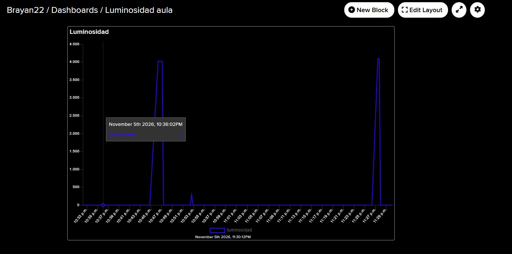

*Figura 7. Dashboard de Adafruit IO con datos en tiempo real.*

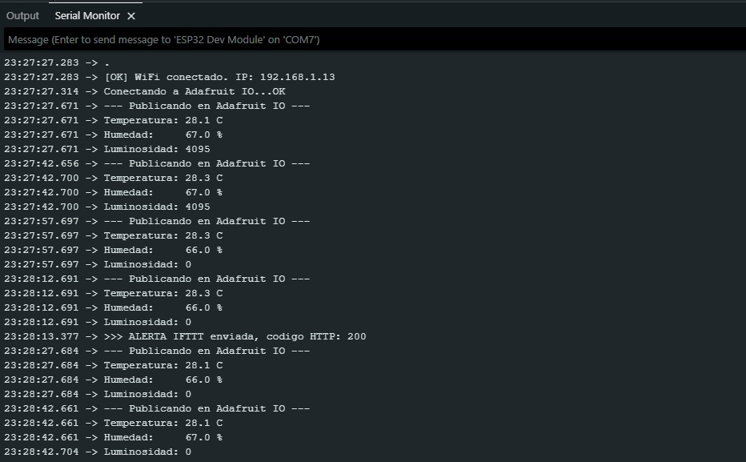

*Figura 8. Monitor serial durante la publicación en el feed luminosidad.*

## 7. Fase 3: Visualización histórica

En Adafruit IO se crea un dashboard («Luminosidad aula») con un widget Line Chart asociado al feed luminosidad (actividad 3.1). El sistema se dejó funcionando cerca de una hora (de las 10:33 p. m. a las 11:30 p. m.), mucho más de los 5 minutos mínimos, para observar la evolución de la curva.

| Widget (bloque) | Feed | Tipo | Configuración |
|---|---|---|---|
| Line Chart | luminosidad | Lectura | Historial de la luminosidad; ventana de tiempo que permita ver varios minutos de datos |


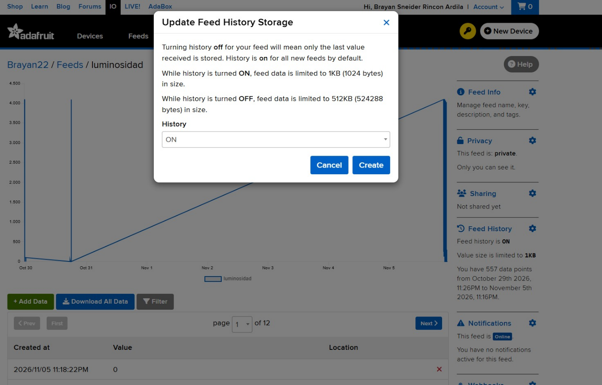

*Figura 9. Gráfico histórico de la luminosidad en Adafruit IO.*

#### Análisis de tendencia

Se responde lo solicitado en la actividad 3.2 con base en la gráfica obtenida.

| Pregunta | Respuesta |
|---|---|
| ¿La luminosidad se mantuvo estable o presentó picos? | Presentó picos: se mantuvo en 0 durante tramos largos (sensor cubierto) y tuvo tres subidas, a unos 4.030 (22:46 a 22:48), a unos 300 (22:53) y a 4.095 (23:27 a 23:29) |
| ¿En qué momento del día se detectó el valor más bajo? | Entre las 22:48 y las 23:27 del 5 de noviembre, salvo el pico de las 22:53; el primer punto visible, de las 22:36, ya marcaba 0 |
| Valor mínimo y máximo observados (lux) | Mínimo 0 (oscuridad total) y máximo 4.095 (23:27); con luz ambiental se observaron 4022 a 4026 |
| Relación de los picos con las pruebas (cubrir o descubrir el sensor) | Cada subida coincide con descubrir el sensor y cada caída a 0 con cubrirlo con la mano; la caída de las 22:47 fue la que disparó la alerta de IFTTT |

## 8. Fase 4: Automatización con IFTTT

Esta fase crea el Applet que convierte el aviso del ESP32 en una notificación (actividad 4.1) y la prueba de la alerta (actividad 4.2).

#### Configuración del Applet

- **Cuenta:** ingresar a ifttt.com, crear una cuenta o iniciar sesión, e instalar la app de IFTTT en el celular.
- **Crear:** hacer clic en «Create».
- **This (Trigger):** buscar el servicio «Webhooks», seleccionar «Receive a web request» y escribir el nombre del evento luminosidad_baja, el mismo que usa el código del ESP32.
- **That (Action):** buscar el servicio «Notifications», seleccionar «Send a notification from the IFTTT app» y escribir el mensaje con {{Value1}}, que recibe el valor enviado por el ESP32.
- **Activar:** guardar el Applet y activarlo.

| Elemento | Configuración |
|---|---|
| Servicio This | Webhooks |
| Trigger | Receive a web request |
| Evento | luminosidad_baja (nombre que el ESP32 llama por HTTPS) |
| Condición de disparo | El ESP32 lo llama cuando la luminosidad es menor que 100 durante 2 lecturas seguidas |
| Servicio That | Notifications |
| Acción | Send a notification from the IFTTT app |
| Mensaje | ALERTA: Luminosidad baja en el aula. Valor actual: {{Value1}} lux. Verificar iluminación. |
| Estado del Applet | Activo («Connected») |

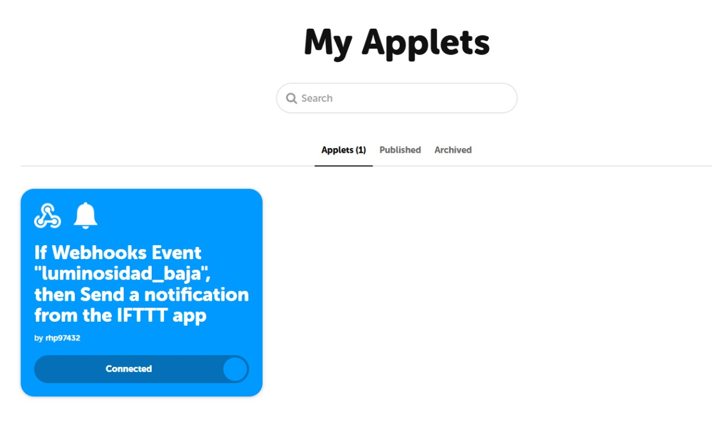

*Figura 10. Applet de IFTTT configurado y activo.*

#### Prueba de la alerta

Se cubre el sensor LDR (o se apagan las luces) para simular una luminosidad menor que 100 lux y se espera la notificación push en el celular.

| Verificación | Resultado esperado | Resultado obtenido | ¿Cumple? |
|---|---|---|---|
| Cubrir el sensor | El monitor serial muestra un valor menor que 100 lux | A las 22:47:21 y 22:47:36 el monitor serial mostró «Luminosidad: 0», por debajo de 100 | Sí |
| Disparo del Applet | IFTTT registra la ejecución del Applet | A las 22:47:37 el monitor imprimió «ALERTA IFTTT enviada, codigo HTTP: 200»; se repitió a las 23:28:13 en la segunda prueba | Sí |
| Notificación en el celular | Llega el mensaje con el valor actual en lugar de {{Value}} | A las 10:47 p. m. llegó «ALERTA: Luminosidad baja en el aula. Valor actual: 0 lux. Verificar iluminación.» | Sí |
| Tiempo hasta la notificación | Pocos segundos o minutos después de publicar el dato bajo | Cerca de 1 s después de la segunda lectura baja; unos 15 a 30 s desde que se cubrió el sensor, por las 2 lecturas seguidas | Sí |
| Descubrir el sensor | El valor vuelve a ser mayor que 100 lux | Al destapar el valor volvió a más de 4000, el contador de lecturas bajas se reinició y no hubo más alertas | Sí |

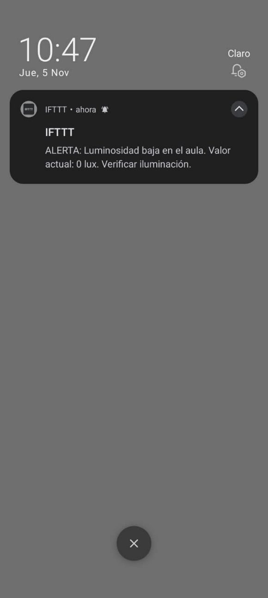

*Figura 11. Notificación push recibida en el celular.*


*Figura 12. Monitor serial con la luminosidad por debajo del umbral.*

- **Nota:** si IFTTT no dispara la alerta, se revisa que el código HTTP impreso sea 200, que el nombre del evento coincida con el del Applet y que la IFTTT_KEY de config.h sea la del servicio Webhooks.

## 9. Fallos de conexión y estrategias de recuperación

Se documentan los fallos más probables en este flujo, cómo se detectan y cómo se resuelven.

#### Fallos documentados

| Fallo | Causa probable | Cómo se detecta | Solución |
|---|---|---|---|
| Credenciales rechazadas | Usuario o AIO Key mal escritos en config.h | client.state() devuelve 4 o 5 (rc=4 o rc=5) | Copiar de nuevo el usuario y la AIO Key desde Adafruit IO |
| El feed no recibe datos | Nombre del feed distinto al del tópico | El dashboard no se actualiza | Revisar que el feed se llame luminosidad y el usuario del tópico |
| El Applet no se dispara | Nombre de evento distinto, IFTTT_KEY incorrecta o pocas lecturas bajas | El monitor serial muestra un código HTTP distinto de 200 o no hay ejecuciones en IFTTT | Revisar el evento luminosidad_baja y la IFTTT_KEY; confirmar 2 lecturas seguidas bajo 100 |
| No llega la notificación | App de IFTTT sin sesión o sin permisos de notificaciones | Applet ejecutado pero sin aviso en el celular | Iniciar sesión en la app y permitir las notificaciones |
| Lectura fija en 0 o 4095 | Cableado incorrecto o escala invertida | El valor no cambia al cubrir el sensor | Revisar VCC, GND y AO; probar INVERTIR_LUZ |
| Sesión MQTT inestable | delay() largos o sin client.loop() | Desconexiones repetidas | Usar millis() y llamar a client.loop() en cada vuelta |
| Publicación rechazada | Más de 30 datos por minuto en el plan gratuito | Aviso en usuario/throttle | Publicar 3 datos cada 15 s (12 por minuto) |

#### Fallos observados durante la práctica

Se registran los fallos que realmente se presentaron en el laboratorio con la solución aplicada.

| Hora | Fallo observado | Mensaje o síntoma | Solución aplicada |
|---|---|---|---|
| 22:30 (pruebas previas) | Escala del LDR invertida | Con luz el valor era bajo y al cubrir el sensor subía, el alerta se disparaba al revés | Se activó INVERTIR_LUZ para que la oscuridad dé un valor bajo |
| 22:35 (pruebas previas) | Alertas repetidas | Una lectura aislada en 0 mandaba una notificación y se repetía en cada ciclo | Se exigieron 2 lecturas seguidas bajo 100 y 60 s de espera entre alertas |
| 22:35 (pruebas previas) | Dato del DHT11 no válido | «[ERROR] Fallo lectura DHT11, revisa el cableado» en una lectura | Se revisó el cable de DATA en el GPIO 27 y se esperó la siguiente lectura |
| 22:46 | Conexión WiFi lenta | El monitor imprimió puntos durante unos 4 s antes de «WiFi conectado» | Se esperó la conexión (hasta 20 s) y la sesión MQTT se abrió sola con reconnect() |

#### Estrategias de recuperación

| Estrategia | Descripción | Dónde se implementa |
|---|---|---|
| Reconexión WiFi | Si no hay red, se reinicia WiFi.begin() cada 5 s sin detener el programa | reconnect() |
| Reconexión MQTT | Con red disponible pero sin broker, se intenta conectar cada 5 s con usuario y AIO Key | reconnect() |
| Publicación inmediata al reconectar | Al recuperar la sesión se publica sin esperar los 15 s | reconnect() |
| Sesión siempre atendida | client.loop() se ejecuta en cada vuelta y no hay esperas largas | loop() |
| Control del límite de tasa | Se publican 3 datos cada 15 s (12 por minuto), muy por debajo de 30 | INTERVALO_ENVIO |
| Anti-repetición de alertas | Se exigen 2 lecturas seguidas bajo 100 y 60 s entre notificaciones | publicarDatos() |

## 10. Código comentado

## Código utilizado

```cpp
/*
 * SEMANA 13 - Adafruit IO + IFTTT (Webhook)
 * Lee TODOS los sensores y los publica en Adafruit IO cada 15 s:
 *   - temperatura (DHT11) -> feed "temperatura"
 *   - humedad     (DHT11) -> feed "humedad"
 *   - luminosidad (LDR)   -> feed "luminosidad"
 * Alerta inmediata: cuando la luminosidad es < 100 el ESP32 llama a un Webhook de IFTTT
 * y el applet envia la notificacion push al celular con el valor.
 *
 * Hardware : ESP32 + DHT11 (DATA -> GPIO 27) + modulo LDR (DO -> GPIO 34)
 * Librerias: PubSubClient (Nick O'Leary) y DHT sensor library (Adafruit)
 * Credenciales en config.h (NO se sube a GitHub).
 */

#include <WiFi.h>
#include <WiFiClientSecure.h>
#include <HTTPClient.h>
#include <PubSubClient.h>
#include <DHT.h>
#include "config.h"

#define DHTPIN  27   // Dato del DHT11
#define DHTTYPE DHT11
#define LDR_PIN 34   // Salida del modulo LDR (solo entrada)

// Con este modulo: MAS luz = numero BAJO, oscuridad = numero ALTO.
// Con true se invierte para que "oscuro" de un numero BAJO (< 100).
#define INVERTIR_LUZ true

const unsigned long INTERVALO_ENVIO     = 15000;  // 15 s
const unsigned long INTERVALO_REINTENTO = 5000;

// --- Alerta por webhook de IFTTT ---
const char*   IFTTT_EVENT          = "luminosidad_baja";  // mismo nombre que en el applet
const int     UMBRAL_LUZ           = 100;
const int     LECTURAS_PARA_ALERTA = 2;       // lecturas seguidas bajo el umbral (1 = inmediato)
const unsigned long ESPERA_ALERTA  = 60000;   // minimo 60 s entre alertas

DHT dht(DHTPIN, DHTTYPE);
WiFiClient espClient;
PubSubClient client(espClient);

char topicTemp[80];
char topicHum[80];
char topicLuz[80];
unsigned long ultimoEnvio = 0;
unsigned long ultimoIntentoMQTT = 0;
unsigned long ultimaAlerta = 0;
bool alertaEnviadaAntes = false;
int lecturasOscuro = 0;

// Promedia 20 lecturas (0-4095); oscuro = valor bajo
int leerLuminosidad() {
  long suma = 0;
  for (int i = 0; i < 20; i++) {
    suma += analogRead(LDR_PIN);
    delay(5);
  }
  int valor = suma / 20;
  if (INVERTIR_LUZ) valor = 4095 - valor;
  return valor;
}

void conectarWiFi() {
  Serial.print("Conectando a WiFi: ");
  Serial.println(WIFI_SSID);

  WiFi.mode(WIFI_STA);
  WiFi.disconnect(true);
  delay(500);
  WiFi.begin(WIFI_SSID, WIFI_PASSWORD);

  unsigned long inicio = millis();
  while (WiFi.status() != WL_CONNECTED && millis() - inicio < 20000) {
    delay(500);
    Serial.print(".");
  }

  if (WiFi.status() == WL_CONNECTED) {
    Serial.println("\n[OK] WiFi conectado. IP: " + WiFi.localIP().toString());
  } else {
    Serial.print("\n[ERROR] Sin WiFi. Estado: ");
    Serial.println(WiFi.status());
  }
}

// reconnect(): mantiene viva la conexion MQTT sin bloquear el loop
void reconnect() {
  if (WiFi.status() != WL_CONNECTED) {
    conectarWiFi();
    return;
  }
  if (!client.connected() && millis() - ultimoIntentoMQTT >= INTERVALO_REINTENTO) {
    ultimoIntentoMQTT = millis();
    Serial.print("Conectando a Adafruit IO...");
    if (client.connect(MQTT_CLIENT_ID, AIO_USERNAME, AIO_KEY)) {
      Serial.println("OK");
      ultimoEnvio = millis() - INTERVALO_ENVIO;   // publica de inmediato
    } else {
      Serial.print("Fallo, rc=");
      Serial.println(client.state());   // 4 = usuario/clave mal, 5 = no autorizado
    }
  }
}

// Llama al webhook de IFTTT mandando el valor como value1
void enviarAlertaIFTTT(int valor) {
  WiFiClientSecure seguro;
  seguro.setInsecure();   // sin verificar certificado (suficiente para el laboratorio)
  HTTPClient http;
  http.setTimeout(8000);

  String url = String("https://maker.ifttt.com/trigger/") + IFTTT_EVENT +
               "/with/key/" + IFTTT_KEY + "?value1=" + String(valor);

  if (http.begin(seguro, url)) {
    int codigo = http.GET();
    Serial.print(">>> ALERTA IFTTT enviada, codigo HTTP: ");
    Serial.println(codigo);   // 200 = IFTTT la recibio
    http.end();
  } else {
    Serial.println(">>> No se pudo iniciar la peticion a IFTTT");
  }
}

void publicarDatos() {
  float temperatura = dht.readTemperature();
  float humedad = dht.readHumidity();
  int luz = leerLuminosidad();

  Serial.println("--- Publicando en Adafruit IO ---");

  if (isnan(temperatura) || isnan(humedad)) {
    Serial.println("[ERROR] Fallo lectura DHT11, revisa el cableado");
  } else {
    client.publish(topicTemp, String(temperatura, 1).c_str());
    client.publish(topicHum, String(humedad, 1).c_str());
    Serial.print("Temperatura: "); Serial.print(temperatura, 1); Serial.println(" C");
    Serial.print("Humedad:     "); Serial.print(humedad, 1); Serial.println(" %");
  }

  client.publish(topicLuz, String(luz).c_str());
  Serial.print("Luminosidad: "); Serial.println(luz);

  // Alerta: luz baja durante LECTURAS_PARA_ALERTA lecturas seguidas
  if (luz < UMBRAL_LUZ) {
    lecturasOscuro++;
  } else {
    lecturasOscuro = 0;
  }

  if (lecturasOscuro >= LECTURAS_PARA_ALERTA &&
      (!alertaEnviadaAntes || millis() - ultimaAlerta >= ESPERA_ALERTA)) {
    enviarAlertaIFTTT(luz);
    ultimaAlerta = millis();
    alertaEnviadaAntes = true;
  }
}

void setup() {
  Serial.begin(115200);
  delay(1000);
  pinMode(LDR_PIN, INPUT);
  dht.begin();

  snprintf(topicTemp, sizeof(topicTemp), "%s/feeds/temperatura", AIO_USERNAME);
  snprintf(topicHum,  sizeof(topicHum),  "%s/feeds/humedad",     AIO_USERNAME);
  snprintf(topicLuz,  sizeof(topicLuz),  "%s/feeds/luminosidad", AIO_USERNAME);

  client.setServer(AIO_SERVER, AIO_PORT);
  ultimoIntentoMQTT = millis() - INTERVALO_REINTENTO;
  conectarWiFi();
}

void loop() {
  reconnect();

  if (client.connected()) {
    client.loop();

    if (millis() - ultimoEnvio >= INTERVALO_ENVIO) {
      ultimoEnvio = millis();
      publicarDatos();
    }
  }
}
```

## Explicación del código

#### Declaraciones y parámetros globales

- **Librerías #include <WiFi.h>, <PubSubClient.h>, <HTTPClient.h> y <DHT.h>:** WiFi.h gestiona la red, PubSubClient implementa el cliente MQTT de Adafruit IO, HTTPClient con WiFiClientSecure llama al Webhook de IFTTT por HTTPS y DHT.h lee el sensor DHT11.
- **Archivo #include "config.h":** Contiene WIFI_SSID, WIFI_PASSWORD, AIO_SERVER, AIO_PORT, AIO_USERNAME, AIO_KEY, MQTT_CLIENT_ID e IFTTT_KEY. Así las credenciales quedan fuera del código principal y del repositorio.
- **Constantes DHTPIN, LDR_PIN e INVERTIR_LUZ:** Definen los pines del DHT11 (GPIO 27) y del LDR (GPIO 34, solo entrada) y si el valor se invierte para que la oscuridad dé un número bajo, menor que 100.
- **Constantes INTERVALO_ENVIO e INTERVALO_REINTENTO:** Definen la publicación cada 15 s y el reintento de conexión cada 5 s, controlados con millis().
- **Constantes UMBRAL_LUZ, LECTURAS_PARA_ALERTA y ESPERA_ALERTA:** Fijan el umbral de 100, las 2 lecturas seguidas necesarias y los 60 s mínimos entre alertas.
- **Variables topicTemp, topicHum, topicLuz, ultimoEnvio, ultimoIntentoMQTT, ultimaAlerta y lecturasOscuro:** Guardan los tópicos de los tres feeds, los instantes de la última publicación, del último intento de conexión y de la última alerta, y el conteo de lecturas seguidas bajo el umbral.

#### Configuración inicial (setup())

- **Serial.begin(115200), pinMode() y dht.begin():** Abren el monitor serial, configuran el pin del LDR como entrada e inician el DHT11.
- **snprintf():** Arma los tópicos de los feeds temperatura, humedad y luminosidad con el usuario de Adafruit IO.
- **WiFi.mode(WIFI_STA), WiFi.disconnect() y WiFi.begin():** Ponen el ESP32 como cliente WiFi, limpian cualquier sesión previa y lanzan la conexión; conectarWiFi() espera hasta 20 s e imprime la IP (192.168.1.13 en la práctica).
- **client.setServer():** Indica el broker io.adafruit.com y el puerto 1883. El primer intento de conexión se programa de inmediato con ultimoIntentoMQTT.

#### Funciones principales

- **leerLuminosidad():** Promedia 20 lecturas analógicas del LDR, con 5 ms entre ellas, y devuelve 4095 menos el promedio cuando INVERTIR_LUZ es verdadero, de modo que la oscuridad da valores cercanos a 0.
- **reconnect():** Si no hay WiFi llama a conectarWiFi(); si hay WiFi pero no broker, cada 5 s llama a client.connect() con usuario y AIO Key y programa la publicación inmediata.
- **publicarDatos():** Lee temperatura, humedad y luminosidad, los publica con client.publish() en sus feeds y los imprime en el monitor serial. Si la luminosidad es menor que 100 durante 2 lecturas seguidas y pasaron 60 s desde la última alerta, llama a enviarAlertaIFTTT().
- **enviarAlertaIFTTT():** Hace una petición HTTPS GET a maker.ifttt.com con el evento luminosidad_baja, la IFTTT_KEY y el valor como value1; el código HTTP 200 confirma que IFTTT recibió el aviso.
- **Funciones de la librería PubSubClient utilizadas**

| Función | Qué hace | Dónde se usa |
|---|---|---|
| client.setServer() | Define el servidor y el puerto del broker | setup() |
| client.connect() | Abre la sesión MQTT con ID de cliente, usuario y AIO Key | reconnect() |
| client.publish() | Envía un valor a un tópico (feed) | publicarDatos() |
| client.loop() | Mantiene la sesión MQTT viva | loop() |
| client.connected() y client.state() | Informan si hay sesión y el código del último fallo | loop() y reconnect() |

#### Bucle principal de control (loop())

El bucle no usa esperas largas: la publicación y los reintentos se temporizan con millis(). Las únicas esperas con delay() son los 5 ms entre lecturas del ADC y los 500 ms al reiniciar el WiFi.

**Fases de la ejecución:**

- **Comprobación de conexiones:** si falta el WiFi o el broker, se llama a reconnect().
- **Mantenimiento de la sesión:** con conexión, client.loop() atiende los mensajes de la sesión MQTT.
- **Publicación:** cada 15 s se leen el DHT11 y el LDR y se publican los tres feeds.
- **Automatización:** si la luminosidad es menor que 100 en 2 lecturas seguidas, el ESP32 llama al Webhook y IFTTT envía la notificación push.

## Preguntas de Reflexión

**1. ¿Qué ventaja ofrece IFTTT frente a programar el envío de correos directamente desde el ESP32?**

Con IFTTT el ESP32 solo publica el dato y la plataforma se encarga de evaluar la condición y de avisar. Las ventajas principales son:

- **Menos código y memoria:** enviar un correo desde el ESP32 exige un cliente SMTP con conexión cifrada, una librería adicional y varios segundos de espera que pueden afectar la sesión MQTT.
- **Mayor seguridad:** el correo directo obliga a guardar en el firmware el usuario y la clave (o clave de aplicación) de una cuenta de correo. Con IFTTT esas cuentas se gestionan en la plataforma.
- **Cambios sin reprogramar:** el umbral, el mensaje o el destino se modifican en el Applet, sin volver a cargar el código en el ESP32.
- **Más canales:** la misma condición puede enviar notificación push, correo u otras acciones sin escribir código.

La contrapartida es la dependencia de un servicio externo y de los límites de su plan gratuito.

**2. ¿Por qué es importante que el ESP32 publique datos con una frecuencia adecuada (10–15 s) para que IFTTT funcione correctamente?**

El ESP32 evalúa la luminosidad cada vez que publica y, si hay luz baja, llama a IFTTT. Si publica con muy poca frecuencia, una caída de luz breve puede pasar entre dos lecturas sin ser detectada y la alerta llega tarde. Si publica con demasiada frecuencia, se supera el límite de 30 datos por minuto del plan gratuito de Adafruit IO, que rechaza datos y puede bloquear temporalmente la cuenta. Un dato cada 10 a 15 s equivale a 4 a 6 datos por minuto por feed: mantiene la alerta oportuna, deja un margen amplio frente al límite y mantiene la sesión MQTT activa con un bucle sin esperas largas.

**3. ¿Qué otras acciones (That) podrían configurarse en IFTTT además de la notificación push, y cómo beneficiarían al proyecto integrador?**

Según los servicios disponibles en el plan de IFTTT, algunas opciones y su beneficio para el proyecto integrador (Monitoreo Inteligente de Aula) son:

| Acción (That) | Beneficio para el proyecto integrador |
|---|---|
| Enviar un correo electrónico | Deja un aviso con fecha y hora que el coordinador puede revisar después |
| Agregar una fila en Google Sheets | Crea un registro histórico propio de las alertas, que también ayuda a superar la retención de 30 días de Adafruit IO |
| Enviar un mensaje a Telegram o Slack | Avisa a varias personas a la vez, por ejemplo al coordinador y al equipo docente |
| Encender una luz o enchufe inteligente | Corrige la causa: si el aula queda a oscuras, la luz se enciende sola sin esperar a que alguien la atienda |

**4. ¿Qué limitaciones encontró al usar la versión gratuita de Adafruit IO (ej. retención de datos de 30 días)?**

Las limitaciones del plan gratuito que afectan al proyecto son:

| Limitación | Efecto en el proyecto | Cómo se maneja |
|---|---|---|
| Retención de datos de 30 días | No se pueden consultar históricos de más de un mes | Exportar los datos o guardarlos en una base propia o en Google Sheets |
| 30 datos por minuto | Obliga a espaciar las publicaciones | Publicar un dato cada 15 s |
| 10 feeds y 5 dashboards | Limita el número de variables y paneles | Usar solo los feeds necesarios (en esta actividad, uno) |
| Observadas en la práctica | El feed acumuló 557 datos entre el 29 de octubre y el 5 de noviembre (12 páginas) y la gráfica histórica unió con una línea recta los días sin datos | Filtrar y acotar la ventana del dashboard a la última hora; con History en ON cada valor se limita a 1 KB |

## Análisis del sistema

- **Automatización:** La alerta convierte un dato del sensor en un aviso al celular, de modo que nadie tiene que mirar el dashboard; en la prueba llegó a las 10:47 p. m. con el valor 0.
- **Dependencia de la frecuencia:** La alerta solo es tan rápida como lo permite la publicación cada 15 s y las 2 lecturas seguidas; en la práctica tardó entre 15 y 30 s tras cubrir el sensor.
- **Escala del sensor:** El LDR entrega una escala aproximada de 0 a 4095; la notificación habla de «lux», pero para lux reales hay que calibrar o usar un sensor BH1750.
- **Estabilidad de la conexión:** reconnect() y el uso de millis() evitan que la sesión MQTT se pierda por esperas largas.
- **Limitaciones:** Los planes gratuitos de Adafruit IO (30 días de datos) e IFTTT (número limitado de Applets) restringen el uso a largo plazo.

## 11. Conclusiones

- **Alerta automática funcional:** El flujo Sensor → ESP32 → Adafruit IO → IFTTT → Notificación push avisó al celular cuando la luminosidad bajó de 100, sin supervisión constante, con código HTTP 200 en ambas pruebas.
- **Utilidad de la automatización en IoT:** Pasar de observar datos a reaccionar ante ellos hace que el sistema de monitoreo del aula sea realmente útil.
- **Simplicidad de IFTTT:** Cambiar el umbral o la acción se hace en el Applet, sin reprogramar el ESP32 ni mantener un servidor propio.
- **Buenas prácticas:** Publicar cada 15 s, mantener la sesión MQTT con reconnect(), exigir 2 lecturas seguidas antes de alertar y proteger las credenciales con config.h hacen que el sistema sea estable y seguro de compartir.
- **Resultados de la práctica:** Con luz ambiental el ESP32 publicó valores de 4022 a 4026 y al cubrir el sensor el valor cayó a 0. El 5 de noviembre se hicieron dos pruebas (22:47 y 23:28) y en ambas el monitor serial mostró el código HTTP 200 y la notificación llegó al celular a las 10:47 p. m. con el mensaje «Valor actual: 0 lux». El dashboard registró tres picos en cerca de una hora de funcionamiento y el feed acumuló 557 datos con el historial activo. Como observaciones, hubo que invertir la escala del módulo LDR y exigir 2 lecturas seguidas para evitar alertas repetidas.

## 12. Bibliografía

- Adafruit Industries. (s. f.). Adafruit IO documentation. https://learn.adafruit.com/adafruit-io
- Adafruit Industries. (s. f.). Adafruit IO MQTT API. https://io.adafruit.com/api/docs/mqtt
- IFTTT. (s. f.). IFTTT Help Center. https://help.ifttt.com/
- Knolleary. (s. f.). PubSubClient: Arduino Client for MQTT. https://pubsubclient.knolleary.net/
- Espressif Systems. (s. f.). Arduino-ESP32 documentation. https://docs.espressif.com/projects/arduino-esp32/
- Unidades Tecnológicas de Santander. (2026). Presentación Semana 13 y guía de la actividad: Automatización con IFTTT. Material del curso Internet de las Cosas.
